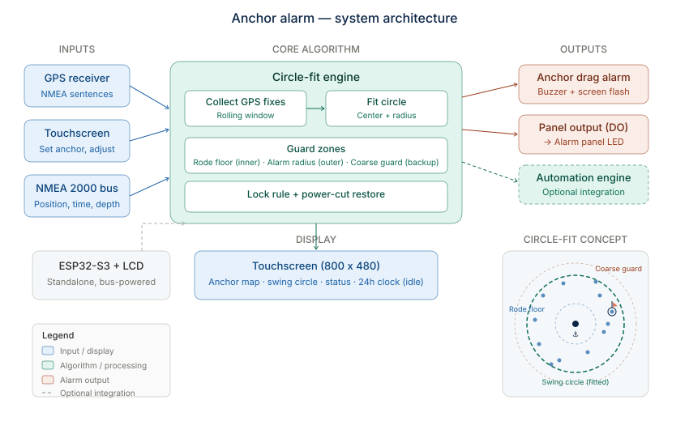

<!--
Purpose: Start-here for the anchor box firmware - what it is, what is live, how to build, test and update it,
  what each file does, and where the hardware facts came from.
Version: v8 (2026-10-09) - v8: engine_link.c in the file map (ANC-42). v7 (2026-10-09) - v7: v0.9.0 live (tank-fill taps). v6 (2026-10-09) - v6: tank-fill taps (fill*, ui_fill, ANC-41) built, not on the box. v5 (2026-10-07) - v5: status to v0.8.0 live (monitoring hosts, night watch, engine alerts + ack); alerts
  files in the file map; test count 163 (documentation pass). v4 (2026-10-06) - v4: night-watch remote files (nightwatch*, ANQ-30); Pi watch on. v3: monitoring-host watch files (hostwatch*, DO1 -> AL-13, ANC-25). v2: the box is LIVE (steps 1-4, firmware v0.4.0 by signed OTA); file map, OTA and host
  tests. v1: step 2 bring-up, never flashed
Scope: PRODUCTION - doc of the live anchor box (private GitHub repo shipboard-sa/anchor-alarm).
Architecture: . - separate project (ANC-14): clean-room ESP-IDF firmware for the anchor
  box aboard (Waveshare ESP32-S3-Touch-LCD-4.3B) + its Python reference model (reference/). Status and open
  items: CHECKPOINT.md; design: wiki/; requirements: SPEC.md. Private GitHub repo shipboard-sa/anchor-alarm (10-02).
Invocation: n/a (reference doc)
-->

# Anchor box firmware (clean-room build)

The anchor box is the touch screen at the nav station (on the post beside the nav desk, at the foot of the companionway ladder - 10-06): a red 24-hour clock when idle, and an anchor watch that fits a
circle to the boat's swing and alarms - on screen and on the CAMS panel's **Anchor Drag (AL-12)** - when the boat
leaves it. Waveshare ESP32-S3-Touch-LCD-4.3B, 800 x 480 touch LCD, on the NMEA 2000 bus. Nothing from the original developer's
anchor-drag-pro is used: his code is "License: Proprietary" (10-02, ANC-01).

## Architecture



Start at [CHECKPOINT.md](CHECKPOINT.md); requirements in [SPEC.md](SPEC.md); design in [wiki/Home.md](wiki/Home.md).

## Status - LIVE since 2026-10-02 (now firmware v0.9.0)

| Step | What | State |
|---|---|---|
| 1 | Python reference model: circle fit, lock rule, rode floor, coarse guard, DRAG?, power-cut restore; boat time | DONE - 163 tests |
| 2 | Board bring-up: panel, touch, expander, outputs OFF at power-up | DONE, on the box |
| 3 | Boat time: MSC-10 GPS time (N2K, listen-only), zone table + US daylight saving, night dimming | DONE, on the box |
| 4 | Anchor watch in C (= the Python in 20 scenarios), WATCH screen, DO0 -> panel AL-12, RE-ARM, PLOT, power-cut restore | DONE, on the box |
| 5 | At the boat: backup, flash, touch / output / wiring tests | DONE except the forced full-ALARM run and a power cycle |
| 6 | Monitoring-host watch: Pi (SignalK) + Cerbo (N2K) down -> DO1 -> panel AL-13 (ANC-25) | v0.5.0; DO1 wired + proven 10-05; Pi side ON since v0.6.0 (ANC-29) |
| 7 | Night-watch remote: bar on the CLOCK, state in the rules engine (ANC-27 / 28 / 31) | v0.6.0 / v0.6.1, on the box |
| 8 | Rules-engine P1 / P2 alerts on the box (ANC-32), tap anywhere acks, panel-LED model (ANC-33) | v0.7.0 / v0.8.0, on the box |
| 9 | 'Filling' taps: FILL button on WATCH -> FILL page, sessions in the rules engine (ANC-41, Ship's Automation D-129) | v0.9.0, on the box since 10-09 (ANQ-35) |

## Updating the box (normal path: signed OTA over Wi-Fi)

ESP-IDF v6.0.3 at `D:\esp\esp-idf`, tools at `D:\esp\.espressif` (nothing on C:). In PowerShell:

```
$env:IDF_TOOLS_PATH='D:\esp\.espressif'; . D:\esp\esp-idf\export.ps1
cd D:\boat\AnchorAlarm
test_host\run.bat                                                     # C ports vs the Python reference
idf.py --no-ccache "-DSDKCONFIG_DEFAULTS=sdkconfig.defaults;sdkconfig.secrets" build
python tools\ota_push.py --host 192.168.1.100                        # --status to just look
```

* Only images signed with `keys/anchorbox_signing_key.pem` install; anything else is refused (tested). Lose the
  key and the next update needs USB - keep a copy off the laptop.
* The box refuses an update while the watch is armed or in ALARM. A new image that does not survive 30 s rolls
  back to the old one by itself.
* Wi-Fi login lives in `sdkconfig.secrets` (gitignored; delete `sdkconfig` after editing so it is re-read).
* Commit and tag first: the box reports `git describe` as its version on the status page.
* Status page (any browser on the boat Wi-Fi): http://192.168.1.100/ - clock, zone, watch state, distance, lock
  reason, last event. Read-only by design.

USB flashing (layout change, recovery) and the bench / test builds: [wiki/Build-Flash-Test.md](wiki/Build-Flash-Test.md).

## Layout

| Path | What |
|---|---|
| `main/` | Firmware (ESP-IDF v6.0.3 + LVGL 9.2) |
| `reference/` | Python reference model + tests (own `.venv`) - the executable spec |
| `test_host/` | PC tests of the C ports against the reference (`run.bat`, zig cc) |
| `tools/` | `ota_push.py` (install), `make_c_vectors.py` / `make_watch_vectors.py` / `make_hostwatch_vectors.py` (test cases from the reference) |
| `wiki/` | Design wiki; `docs/mockups/` clock mock-ups |
| `backup/`, `keys/`, `sdkconfig.secrets` | the original firmware image, the signing key, the Wi-Fi login - gitignored, local only |
| `LICENSE` | MIT (owner's choice). Repo: https://github.com/shipboard-sa/anchor-alarm  |

## Files (main/)

| File | Role |
|---|---|
| `app_main.c` | Entry: board -> display -> screens -> N2K -> Wi-Fi/OTA -> watch -> hostwatch -> nightwatch -> alerts -> fill -> clock |
| `board.c/.h` | Pins, I2C, CH422G (outputs OFF first), LCD reset, RGB panel, touch reset, backlight, DO0/DO1 |
| `ch422g.c/.h`, `gt911.c/.h` | Expander and touch drivers, written from the datasheets |
| `display.c/.h` | LVGL glue: partial render into the panel's PSRAM frame buffer, touch input, UI task + lock |
| `screens.c/.h` | CLOCK / WATCH / ALERT rules: wake tap swallowed, 2-min fallback, ALARM holds WATCH |
| `ui_clock.c/.h` | Red seven-segment HH:MM, anchor state symbol, 'M' (zone pinned), night red |
| `ui_watch.c/.h` | WATCH screen: state, distance, lock reason, warnings, state-driven buttons, ARM / DISARM / RE-ARM / ZONE pages, breadcrumb PLOT, ALARM banner |
| `n2k.c/.h` | NMEA 2000 listen-only: System Time 126992, Position 129025, per-PGN counts, Cerbo addresses from address claims 60928 |
| `hostwatch.c/.h` | Pure C: Pi / Cerbo down decisions + SignalK reply parsing (ANC-25) |
| `hostwatch_ctl.c/.h` | Monitoring-host watch task: Pi poll (ON since 10-06, ANC-29) + router ping, Cerbo frame times, DO1 -> AL-13, screen + status text |
| `nightwatch.c/.h` | Pure C: rules-engine /night-watch reply parsing + what the CLOCK's night-watch bar shows (ANC-27/28) |
| `engine_link.c/.h` | The ONE rules-engine link: one task + one keep-alive HTTP client serving night watch, alerts and fill in turn (ANC-42) |
| `nightwatch_ctl.c/.h` | Night-watch remote (service step on the engine link): GET every 5 s, POST on a tap (bearer token from sdkconfig.secrets), status line |
| `alerts.c/.h` | Pure C: rules-engine /alerts reply parsing, take-over / release / tap rules, CLOCK + WATCH lines (ANC-33) |
| `alerts_ctl.c/.h` | Engine alerts (service step on the engine link): GET /alerts every 2 s, POST /ack on a tap (box token) |
| `ui_alert.c/.h` | ALERT screen: active P1 / P2 alarms, flashing = unacked, steady = acked |
| `fill.c/.h` | Pure C: rules-engine /fill reply parsing (nested JSON), FILL page rows, tab, tap rules (ANC-41) |
| `fill_ctl.c/.h` | Tank fills (service step on the engine link): GET /fill every 10 s (2 s with the page open), POST /fill on a tap (box token), status line |
| `ui_fill.c/.h` | FILL page: four tanks with level + session, FILLING / STOP, watermaker line, BACK |
| `boattime.c/.h` | Pure C: zone table, US DST, nautical zone, steadiness, pin, GPS time acceptance, sun -> night |
| `boatclock.c/.h` | Clock loop: boat time -> CLOCK, zone pin (NVS), status lines, expander refresh, health mark |
| `anchorwatch.c/.h` | Pure C port of reference geo + fit + watch, with snapshot / restore |
| `watch_ctl.c/.h` | Runs the watch at 1 Hz: feed, DO0 = ALARM, wake screen, circle saved / restored (NVS), breadcrumbs, RE-ARM |
| `net.c/.h` | Wi-Fi, mDNS, status page, signed OTA (+ test-only output pulse behind a Kconfig switch) |

## Hardware facts and their sources (clean room)

All in [wiki/Hardware.md](wiki/Hardware.md), each with its source: Waveshare wiki + schematic
(`ESP32-S3-Touch-LCD-4.3B-Sch.pdf`, 2024-10-23), WCH CH422 and Goodix GT911 datasheets, ESPHome's published panel
timings, canboat's PGN database (Apache-2.0) and the MSC-10 install manual (PGN list).
